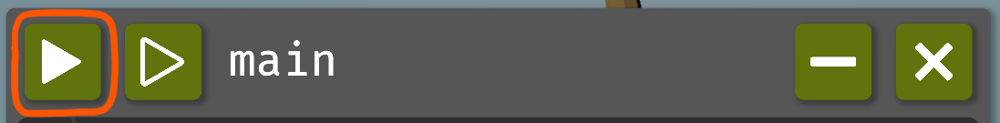

[Documentation index](../README.md)

[<- Getting Started](getting_started.md)  | [While Loop ->](scripting/while.md)

---

# First Program

## Text Editor

All programming is done in code windows. Each code window corresponds to a text file containing code. 
You can rename the file by clicking on its name at the top of the window.

You can edit the code as you would in any text editor, as long as it isn't running.
You can execute the program directly by pressing the green play button in the code window.


You can create more code files using the "+" button in the upper right corner of the screen.
You can dock a window to another window by dragging it onto it.

You will notice that once you start typing, a simple code completion window will pop up.
Press Tab to insert the selected completion.
Use the arrow keys to navigate through the completion options.

Don't worry if this is your first time programming. The language is unlocked step by step, so you won't be overwhelmed by all the things you can do. 
The syntax is also similar to Python, one of the most widely used programming languages in the world, so what you learn here will be useful elsewhere.

If you already know Python, that's fine too: you'll be able to move through the early game quickly and get to the more interesting stuff.

Currently, there are two drone commands available.

`harvest()`

and 

`do_a_flip()`

These are function calls. You can think of a function as a command that can be executed. The `()` parentheses execute it.

Try typing these statements in the code window and pressing the execute button.

You can think of your code as a sequence of statements. You can run multiple statements in a row by placing them on multiple lines. 
Try pressing the play button on this embedded code window to see how the code executes:

**Example conditions**

```json
{
  "items": [],
  "world_size": {
    "x": 1,
    "y": 1
  },
  "execution_speed": 1,
  "digging_speed": 1,
  "action_ticks": 200,
  "operation_ticks": 200,
  "seed": 1,
  "exclude_unlocks": [
    "watering",
    "fertilizer"
  ],
  "starting_chunk": 0,
  "dlc_enabled": false
}
```

**Example code**

```python
do_a_flip()
harvest()
harvest()
```

<details>
<summary>Animated example</summary>


*Offline recreation using extracted game models; simplified visuals. Clips are limited to 30 seconds.*

</details>

## Unlocks

Collecting grass will give you hay. Hay can be used to unlock loops in the tech tree. Open the tech tree with the button in the top right corner of the screen.

---

[External Editor](external_editor.md)      [Comments](scripting/comments.md)      [While Loop](scripting/while.md)

[harvest()](../code/harvest.md)      [do_a_flip()](../code/do_a_flip.md)

Source: `EN/docs/first_program.md`.
