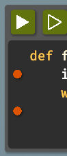

[Documentation index](../../README.md)

[<- Plant](../unlocks/plant.md)  | [Debug 2 ->](../unlocks/debug2.md)
 | [Timing ->](../unlocks/timing.md)

---

# Debug

Sometimes your code just doesn't work and you need to find out why. There are a couple of tools to help you do that.

The first is to execute the program step by step. 
You can go into step-by-step mode with the button next to the Execute button or by setting a breakpoint.

Breakpoints can be added by clicking on the breakpoint panel to the left of the code.

When execution reaches the line where the breakpoint is, it will automatically switch to step-by-step mode.

When you move your mouse over a variable, its current value is displayed.

The `print()` function can also be very useful. It will write any value passed to it directly into the air.

Examples:

**Example conditions**

```json
{
  "execution_speed": 1,
  "digging_speed": 1,
  "action_ticks": 200,
  "operation_ticks": 100,
  "seed": 0,
  "exclude_unlocks": [
    "watering",
    "fertilizer"
  ],
  "starting_chunk": 0,
  "dlc_enabled": false
}
```

**Example code**

```python
print(0.24)
```

<details>
<summary>Example output</summary>

<pre>0.24</pre>

</details>

**Example conditions**

```json
{
  "execution_speed": 1,
  "digging_speed": 1,
  "action_ticks": 200,
  "operation_ticks": 100,
  "seed": 0,
  "exclude_unlocks": [
    "watering",
    "fertilizer"
  ],
  "starting_chunk": 0,
  "dlc_enabled": false
}
```

**Example code**

```python
print(can_harvest())
```

<details>
<summary>Example output</summary>

<pre>False</pre>

</details>

**Example conditions**

```json
{
  "execution_speed": 1,
  "digging_speed": 1,
  "action_ticks": 200,
  "operation_ticks": 100,
  "seed": 0,
  "exclude_unlocks": [
    "watering",
    "fertilizer"
  ],
  "starting_chunk": 0,
  "dlc_enabled": false
}
```

**Example code**

```python
print(get_pos_x(), get_pos_y())
```

<details>
<summary>Example output</summary>

<pre>0 0</pre>

</details>

The `print()` function prints the value directly into the air and to the [Output](../output.md) page.

Writing into the air can sometimes be a bit slow if you want to print a lot of values.
In this case, you can use the `quick_print()` function, which prints only to the output window.

The output window also logs warnings and errors, so it can be useful to check when something doesn't work as expected.

When execution stops, the output is also written to the output.txt (`<game-data>/output.txt`) file in the game folder.

---

[Output](../output.md)      [Comments](comments.md)      [Debug 2](../unlocks/debug2.md)      [Colorful Blocks](../unlocks/debug_place.md)      [Simulation](../unlocks/simulation.md)

[print()](../../code/print.md)      [quick_print()](../../code/quick_print.md)

Source: `EN/docs/scripting/debug.md`.
