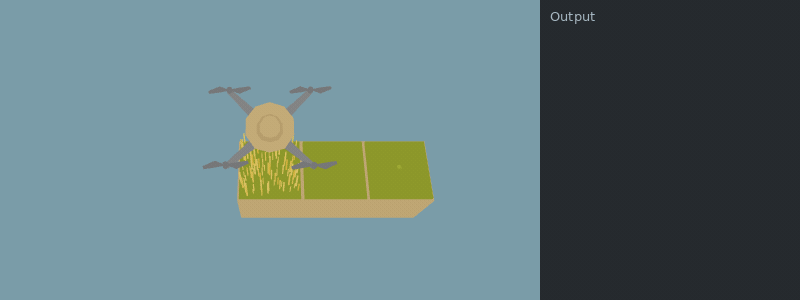

[Documentation index](../../README.md)

[<- Lists](lists.md)  | [Costs ->](../unlocks/costs.md)

---

# Dictionaries

Dictionaries are a data structure that maps keys to values, much like a real dictionary maps words to their definitions. It allows you to look up these values very quickly.

A dictionary can be created like this:

**Example conditions**

```json
{
  "execution_speed": 1,
  "digging_speed": 1,
  "action_ticks": 200,
  "operation_ticks": 100,
  "seed": 0,
  "exclude_unlocks": [
    "watering",
    "fertilizer"
  ],
  "starting_chunk": 0,
  "dlc_enabled": false
}
```

**Example code**

```python
right_of = {North:East, East:South, South:West, West:North}
```

<details>
<summary>Example output</summary>

*No output.*

</details>

The expression before the colon is the key and the expression after the colon is the value to which the key maps.
The above dictionary maps each direction to the direction to its right.

Here's another dictionary that maps the drone's position to the entity beneath it.

**Example conditions**

```json
{
  "execution_speed": 1,
  "digging_speed": 1,
  "action_ticks": 200,
  "operation_ticks": 100,
  "seed": 0,
  "exclude_unlocks": [
    "watering",
    "fertilizer"
  ],
  "starting_chunk": 0,
  "dlc_enabled": false
}
```

**Example code**

```python
x, y = get_pos_x(), get_pos_y()
entity_dict = {(x,y):get_entity_type()}
```

<details>
<summary>Example output</summary>

*No output.*

</details>

Accessing the value mapped to a key is similar to accessing an element in a list:
`value = dict[key]`

**Example conditions**

```json
{
  "execution_speed": 1,
  "digging_speed": 1,
  "action_ticks": 200,
  "operation_ticks": 100,
  "seed": 0,
  "exclude_unlocks": [
    "watering",
    "fertilizer"
  ],
  "starting_chunk": 0,
  "dlc_enabled": false
}
```

**Example code**

```python
right_of = {North:East, East:South, South:West, West:North}
print(right_of[South])
```

<details>
<summary>Example output</summary>

<pre>West</pre>

</details>

You can add a new key-value pair to a dictionary like this:
`dict[key] = value`

**Example conditions**

```json
{
  "items": [],
  "world_size": {
    "x": 3,
    "y": 1
  },
  "execution_speed": 1,
  "digging_speed": 1,
  "action_ticks": 200,
  "operation_ticks": 100,
  "seed": 1,
  "exclude_unlocks": [
    "watering",
    "fertilizer"
  ],
  "starting_chunk": 0,
  "dlc_enabled": false
}
```

**Example setup**

```python
move(East)
plant(Entities.Bush)
move(East)
plant(Entities.Tree)
move(East)
```

**Example code**

```python
entity_dict = {}
for _ in range(3):
	entity_dict[(get_pos_x(), get_pos_y())] = get_entity_type()
	move(East)
print(entity_dict)
```

<details>
<summary>Animated example</summary>



*Offline recreation using extracted game models; simplified visuals. Clips are limited to 30 seconds.*

</details>

<details>
<summary>Example output</summary>

<pre>{(0,0):Entities.Grass,(1,0):Entities.Bush,(2,0):Entities.Tree}</pre>

</details>

Keys are unique, so adding a key that already exists in the dictionary will overwrite the previous value.

Use `dict.pop(key)` to remove a key-value pair from `dict`.

`key in dict` evaluates to `True` if `key` is a key in the `dict` and `False` otherwise.
So you can use `if key in dict:` to check if `dict` contains the key.

Putting a dictionary in a `for` loop allows you to iterate over all its keys:

**Example conditions**

```json
{
  "execution_speed": 1,
  "digging_speed": 1,
  "action_ticks": 200,
  "operation_ticks": 100,
  "seed": 0,
  "exclude_unlocks": [
    "watering",
    "fertilizer"
  ],
  "starting_chunk": 0,
  "dlc_enabled": false
}
```

**Example code**

```python
right_of = {North:East, East:South, South:West, West:North}
print(North in right_of)
for key in right_of:
	value = right_of[key]
	print(key, ":", value)
```

<details>
<summary>Example output</summary>

<pre>True
North : East
East : South
South : West
West : North</pre>

</details>

There are no guarantees about the order in which the keys are iterated.

See also [Sets](sets.md)

---

[Lists](lists.md)      [Sets](sets.md)      [Tuples](tuples.md)      [Costs](../unlocks/costs.md)

[len()](../../code/len.md)

Source: `EN/docs/scripting/dicts.md`.
