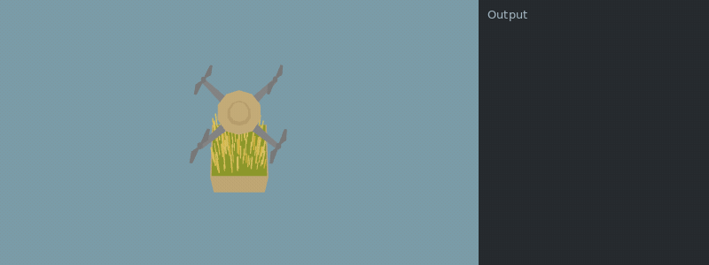
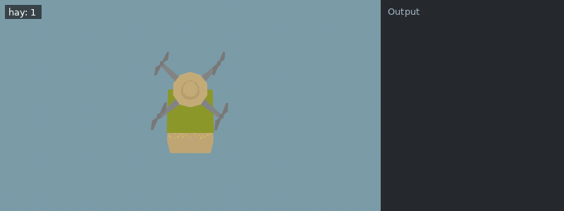

[Documentation index](../../README.md)

[<- Expand 2](../unlocks/expand_2.md)

---

# For Loop

The `for` loop works as it does in Python. It is called a foreach loop in some languages and should not be confused with the C-style for loop, which works differently.

```python
for i in sequence:
	#do something with i
```

Similar to the `while` loop, the `for` loop also repeatedly calls a block of code. Instead of looping based on a condition, it executes the loop body once for each element in a sequence.

## Syntax

A for loop looks like this:

```python
for variable_name in sequence:
	#code block
```

`variable_name` can be any name you choose. It is a variable that stores the current element in the sequence. `sequence` must be an iterable value, such as a range of numbers. The code block is executed once for every element, with the loop variable assigned to that element.

## Sequences

[Ranges](../../code/range.md)      [Lists](lists.md)      [Tuples](tuples.md)      [Dictionaries](dicts.md)      [Sets](sets.md)

## Example

**Example conditions**

```json
{
  "items": [],
  "world_size": {
    "x": 1,
    "y": 1
  },
  "execution_speed": 1,
  "digging_speed": 1,
  "action_ticks": 200,
  "operation_ticks": 100,
  "seed": 1,
  "exclude_unlocks": [
    "watering",
    "fertilizer"
  ],
  "starting_chunk": 0,
  "dlc_enabled": false
}
```

**Example setup**

```python
do_a_flip()
```

**Example code**

```python
for i in range(5):
    harvest()
```

<details>
<summary>Animated example</summary>



*Offline recreation using extracted game models; simplified visuals. Clips are limited to 15 seconds.*

</details>

This loop executes the body a fixed number of times. It is essentially the same as writing

**Example conditions**

```json
{
  "items": [],
  "world_size": {
    "x": 1,
    "y": 1
  },
  "execution_speed": 1,
  "digging_speed": 1,
  "action_ticks": 200,
  "operation_ticks": 100,
  "seed": 1,
  "exclude_unlocks": [
    "watering",
    "fertilizer"
  ],
  "starting_chunk": 0,
  "dlc_enabled": false
}
```

**Example setup**

```python
do_a_flip()
```

**Example code**

```python
i = 0
harvest()
i = 1
harvest()
i = 2
harvest()
i = 3
harvest()
i = 4
harvest()
```

<details>
<summary>Animated example</summary>



*Offline recreation using extracted game models; simplified visuals. Clips are limited to 15 seconds.*

</details>

---

[While Loop](while.md)      [Break](break.md)      [Continue](continue.md)

[range()](../../code/range.md)

Source: `EN/docs/scripting/for.md`.
