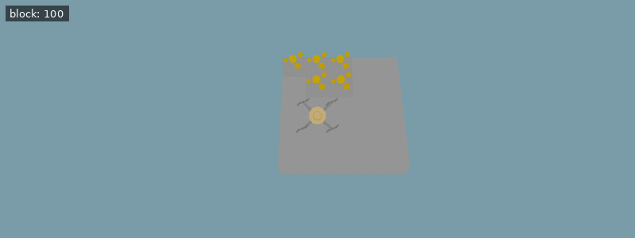

[Documentation index](../../README.md)

[<- Bamboo](bamboo.md)

---

# Colorful Blocks

As you might already know, you can use `place()` to make your drone place a block. This unlock adds three colored blocks that are visually distinct from their surroundings, `Grounds.Block_Red`, `Grounds.Block_Green` and `Grounds.Block_Blue`.

Colored blocks can be used to mark things or make pretty patterns.

To place the new blocks:

**Example conditions**

```json
{
  "items": [
    {
      "item": "block",
      "n": 100
    }
  ],
  "world_size": {
    "x": 5,
    "y": 5
  },
  "execution_speed": 5,
  "digging_speed": 4,
  "action_ticks": 200,
  "operation_ticks": 200,
  "seed": 1,
  "exclude_unlocks": [
    "watering",
    "fertilizer",
    "mushrooms",
    "coal"
  ],
  "starting_chunk": 2
}
```

**Example setup**

```python
move(East)
move(North)
```

**Example code**

```python
place(Grounds.Block_Green)
move(East)

place(Grounds.Block_Blue)
move(East)

place(Grounds.Block_Green)
move(North)

place(Grounds.Block_Blue)
move(North)

place(Grounds.Block_Green)
move(West)

place(Grounds.Block_Blue)
move(West)

place(Grounds.Block_Green)
move(South)

place(Grounds.Block_Blue)
move(East)

place(Grounds.Block_Red)
place(Grounds.Block_Red)

do_a_flip()
```

<details>
<summary>Animated example</summary>



*Offline recreation using extracted game models; simplified visuals. Clips are limited to 15 seconds.*

</details>

---

[Debug](../scripting/debug.md)      [Debug 2](debug2.md)      [Bamboo](bamboo.md)

[place()](../../code/place.md)

Source: `EN/docs/unlocks/debug_place.md`.
