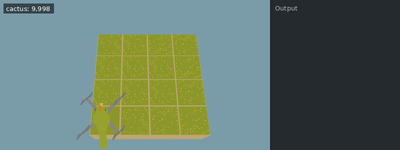

[Documentation index](../../README.md)

[<- Cactus](cactus.md)

---

# Dinosaurs

Dinosaurs are ancient, majestic creatures that can be farmed for ancient bones.

Unfortunately, dinosaurs went extinct a long time ago, so the best we can do now is dress up as one.
For this purpose, you have received the new dinosaur hat.

The hat can be equipped with
`change_hat(Hats.Dinosaur_Hat)`

Unfortunately, it doesn't look quite like it did in the advertisement...

If you equip the dinosaur hat and have enough cactus, an [apple](../../objects/apple.md) will automatically be purchased and placed under the drone.
When the drone is over an apple and moves again, it will eat the apple and grow its tail by one. If you can afford it, a new apple will be purchased and placed in a random location.
The apple cannot spawn if something else is planted where it wants to be.

The dinosaur's tail is dragged behind the drone, filling the tiles the drone previously moved over. If the drone tries to move onto its tail, `move()` will fail and return `False`.
The last segment of the tail will move out of the way during a move, so you can move onto it. However, if the snake fills the entire farm, you will no longer be able to move. You can therefore check whether the snake is fully grown by checking whether you can still move.
While wearing the dinosaur hat, the drone can't move over the farm border to get to the other side.

Using `measure()` on an apple will return the position of the next apple as a tuple.

`next_x, next_y = measure()`

**Example conditions**

```json
{
  "items": [
    {
      "item": "cactus",
      "n": 10000
    }
  ],
  "world_size": {
    "x": 4,
    "y": 4
  },
  "execution_speed": 2,
  "digging_speed": 1,
  "action_ticks": 200,
  "operation_ticks": 1,
  "seed": 5,
  "exclude_unlocks": [
    "watering"
  ],
  "starting_chunk": 0,
  "dlc_enabled": false
}
```

**Example code**

```python
change_hat(Hats.Dinosaur_Hat)
while True:
    next_x, next_y = measure()
    while get_pos_x() != next_x:
        move(East)
    while get_pos_y() != next_y:
        move(North)
```

<details>
<summary>Animated example</summary>



*Offline recreation using extracted game models; simplified visuals. Clips are limited to 30 seconds.*

</details>

<details>
<summary>Example output</summary>

*No output.*

*Execution was capped at 30 seconds; output may be incomplete.*

</details>

When the hat is unequipped again by equipping a different hat, the tail will be harvested.
You will receive an amount of bones equal to the tail length squared. For a tail of length `n`, you will receive `n**2` `Items.Bone`.
For example:
length 1 => 1 bone
length 2 => 4 bones
length 3 => 9 bones
length 4 => 16 bones
length 16 => 256 bones
length 100 => 10000 bones

The Dinosaur Hat is very heavy, so if you equip it, it will make `move()` take 400 ticks instead of 200. However, each time you pick up an apple, the number of ticks used by `move()` is reduced by 3% (rounded down), because a longer tail can help you move.

The following loop prints the number of ticks used by `move()` after any number of apples:

**Example conditions**

```json
{
  "execution_speed": 1,
  "digging_speed": 1,
  "action_ticks": 200,
  "operation_ticks": 1,
  "seed": 1,
  "exclude_unlocks": [
    "watering",
    "fertilizer"
  ],
  "starting_chunk": 0,
  "dlc_enabled": false
}
```

**Example code**

```python
ticks = 400
for i in range(100):
    quick_print("ticks after ", i, " apples: ", ticks)
    ticks -= ticks * 0.03 // 1
```

<details>
<summary>Example output</summary>

<pre>ticks after  1  apples:  388
ticks after  2  apples:  377
ticks after  3  apples:  366
ticks after  4  apples:  356
ticks after  5  apples:  346
ticks after  6  apples:  336
ticks after  7  apples:  326
ticks after  8  apples:  317
ticks after  9  apples:  308
ticks after  10  apples:  299
ticks after  11  apples:  291
ticks after  12  apples:  283
ticks after  13  apples:  275
ticks after  14  apples:  267
ticks after  15  apples:  259
ticks after  16  apples:  252
ticks after  17  apples:  245
ticks after  18  apples:  238
ticks after  19  apples:  231
ticks after  20  apples:  225
ticks after  21  apples:  219
ticks after  22  apples:  213
ticks after  23  apples:  207
ticks after  24  apples:  201
ticks after  25  apples:  195
ticks after  26  apples:  190
ticks after  27  apples:  185
ticks after  28  apples:  180
ticks after  29  apples:  175
ticks after  30  apples:  170
ticks after  31  apples:  165
ticks after  32  apples:  161
ticks after  33  apples:  157
ticks after  34  apples:  153
ticks after  35  apples:  149
ticks after  36  apples:  145
ticks after  37  apples:  141
ticks after  38  apples:  137
ticks after  39  apples:  133
ticks after  40  apples:  130
ticks after  41  apples:  127
ticks after  42  apples:  124
ticks after  43  apples:  121
ticks after  44  apples:  118
ticks after  45  apples:  115
ticks after  46  apples:  112
ticks after  47  apples:  109
ticks after  48  apples:  106
ticks after  49  apples:  103
ticks after  50  apples:  100
ticks after  51  apples:  97
ticks after  52  apples:  95
ticks after  53  apples:  93
ticks after  54  apples:  91
ticks after  55  apples:  89
ticks after  56  apples:  87
ticks after  57  apples:  85
ticks after  58  apples:  83
ticks after  59  apples:  81
ticks after  60  apples:  79
ticks after  61  apples:  77
ticks after  62  apples:  75
ticks after  63  apples:  73
ticks after  64  apples:  71
ticks after  65  apples:  69
ticks after  66  apples:  67
ticks after  67  apples:  65
ticks after  68  apples:  64
ticks after  69  apples:  63
ticks after  70  apples:  62
ticks after  71  apples:  61
ticks after  72  apples:  60
ticks after  73  apples:  59
ticks after  74  apples:  58
ticks after  75  apples:  57
ticks after  76  apples:  56
ticks after  77  apples:  55
ticks after  78  apples:  54
ticks after  79  apples:  53
ticks after  80  apples:  52
ticks after  81  apples:  51
ticks after  82  apples:  50
ticks after  83  apples:  49
ticks after  84  apples:  48
ticks after  85  apples:  47
ticks after  86  apples:  46
ticks after  87  apples:  45
ticks after  88  apples:  44
ticks after  89  apples:  43
ticks after  90  apples:  42
ticks after  91  apples:  41
ticks after  92  apples:  40
ticks after  93  apples:  39
ticks after  94  apples:  38
ticks after  95  apples:  37
ticks after  96  apples:  36
ticks after  97  apples:  35
ticks after  98  apples:  34
ticks after  99  apples:  33</pre>

</details>

You only have one dinosaur hat, so only one drone can wear it.

**Show hint 1**

If you keep moving along the same path that covers the whole field, you can easily get a snake that covers the whole field every time. It's not very efficient, but it works.
Fully traversing a very large farm can take a long time and you might not actually need that many bones. Feel free to use `set_world_size()` to change the size of the farm to something more convenient.

---

[Stats](../stats.md)      [Tuples](../scripting/tuples.md)      [Lists](../scripting/lists.md)

[change_hat()](../../code/change_hat.md)      [move()](../../code/move.md)      [measure()](../../code/measure.md)

Source: `EN/docs/unlocks/dinosaurs.md`.
