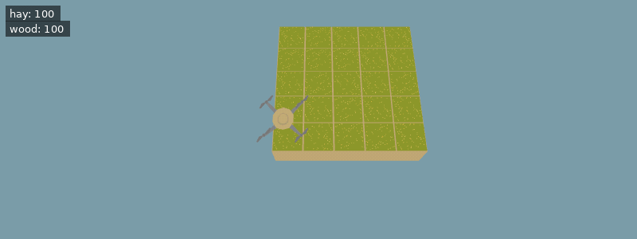

[Documentation index](../../README.md)

[<- Coal](coal.md)  | [Quartz ->](quartz.md)
 | [Iron Prospecting ->](prospecting.md)
 | [Treasure Map ->](treasure_map.md)

---

# Iron

After finding coal in `Grounds.Dirt`, you can dig further down past the `Grounds.Clay` layer and into `Grounds.Rock` to find iron.

In contrast to coal veins, iron veins also extend vertically. But all iron blocks in a vein are always directly adjacent to each other, the blocks never connect only diagonally.

But iron veins start small and you'll need some luck to find them. Further unlocking iron will increase the maximum vein size and make them a bit easier to find by chance. But to find them reliably, you should unlock [prospecting](prospecting.md).

**Example conditions**

```json
{
  "items": [
    {
      "item": "hay",
      "n": 100
    },
    {
      "item": "wood",
      "n": 100
    }
  ],
  "world_size": {
    "x": 5,
    "y": 5
  },
  "execution_speed": 1,
  "digging_speed": 10,
  "action_ticks": 200,
  "operation_ticks": 50,
  "seed": 5,
  "exclude_unlocks": [
    "watering",
    "fertilizer",
    "mushrooms",
    "quartz"
  ]
}
```

**Example code**

```python
# Dig until an iron block appears
while get_ground_type() != Grounds.Iron:
    dig()

# Mine the iron
dig()
```

<details>
<summary>Animated example</summary>



*Offline recreation using extracted game models; simplified visuals. Clips are limited to 30 seconds.*

</details>

---

[Stats](../stats.md)      [Mining](mining.md)      [Iron Prospecting](prospecting.md)      [Underground Senses](underground_senses.md)

[move()](../../code/move.md)      [dig()](../../code/dig.md)

Source: `EN/docs/unlocks/iron.md`.
