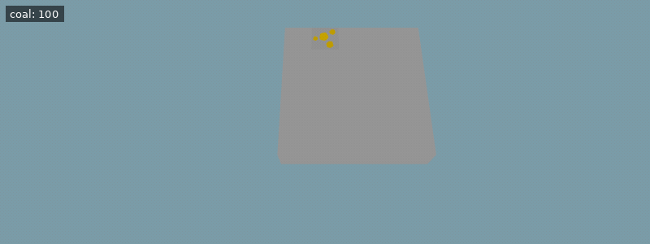

[Documentation index](../../README.md)

[<- Iron](iron.md)

---

# Iron Prospecting

You may have noticed that it is sometimes hard to find iron veins. You could dig around and try to find them by chance, but there's a better way: since iron is magnetic, we can find it from a distance.

The command `prospect_iron()` does exactly that. `prospect_iron()` returns the direction (`North`, `East`, `South`, or `West`) that the drone would have to move in to take a step toward the closest iron ore.

The command costs 1 coal to execute.

`prospect_iron()` returns `None` if the drone is already directly above the closest iron ore, or if you don't have enough coal to execute the command, or if there is no iron in range.

You can use the following code to move one step closer to the next iron ore:

**Example conditions**

```json
{
  "items": [
    {
      "item": "coal",
      "n": 100
    }
  ],
  "world_size": {
    "x": 5,
    "y": 5
  },
  "execution_speed": 1,
  "digging_speed": 10,
  "action_ticks": 200,
  "operation_ticks": 50,
  "seed": 8,
  "exclude_unlocks": [
    "watering",
    "fertilizer",
    "mushrooms",
    "quartz"
  ]
}
```

**Example setup**

```python
jump(Unlocks.Iron)
```

**Example code**

```python
# Make sure prospect returns a direction
if prospect_iron() != None:
    move(prospect_iron()) # Move closer to the iron vein
```

<details>
<summary>Animated example</summary>



*Offline recreation using extracted game models; simplified visuals. Clips are limited to 30 seconds.*

</details>

You may want to optimize this code with a variable because it currently calls `prospect_iron()` twice, costing 2 coal.

## Distance Calculation

The closest iron ore is calculated by the number of steps the drone has to take. If there's an iron ore 2 blocks to the east and 3 blocks to the north of the drone, this counts as a distance of 5, because it would take the drone five steps to travel there.

Digging also counts as a step. So if, additionally, the iron is buried 7 blocks deep underground, this counts as a distance of 12, because it would take the drone five steps to position itself above the iron and then seven digs to reach it.

---

[Iron](iron.md)      [Underground Senses](underground_senses.md)

[move()](../../code/move.md)      [dig()](../../code/dig.md)      [prospect_iron()](../../code/prospect_iron.md)

Source: `EN/docs/unlocks/prospecting.md`.
