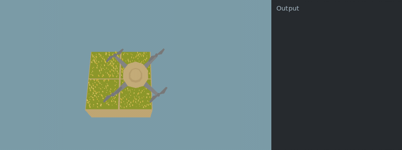
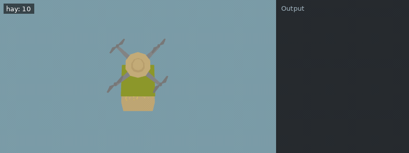
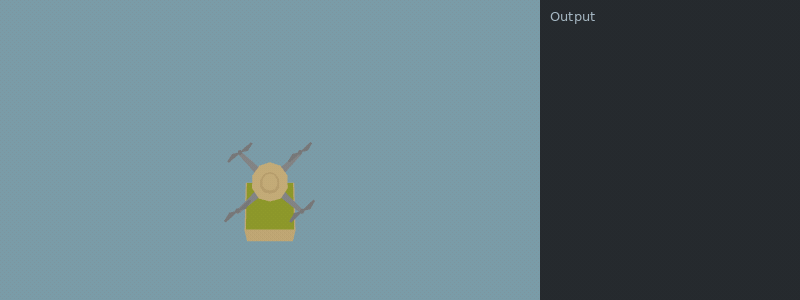

[Documentation index](../../README.md)

[<- Operators](../scripting/operators.md)

---

# Senses

The drone can see now! 

The functions `get_pos_x()` and `get_pos_y()` return the drone's current x- and y-coordinates. At the starting position, both are `0`. The x-coordinate increases by `1` for each tile toward `East`, and the y-coordinate increases by `1` for each tile toward `North`.

**Example conditions**

```json
{
  "items": [],
  "world_size": {
    "x": 2,
    "y": 2
  },
  "execution_speed": 1,
  "digging_speed": 1,
  "action_ticks": 200,
  "operation_ticks": 100,
  "seed": 1,
  "exclude_unlocks": [
    "watering",
    "fertilizer"
  ],
  "starting_chunk": 0,
  "dlc_enabled": false
}
```

**Example setup**

```python
move(East)
```

**Example code**

```python
print("x =", get_pos_x(), "y =", get_pos_y())
if get_pos_x() == 1 and get_pos_y() == 0:
    do_a_flip()
```

<details>
<summary>Animated example</summary>



*Offline recreation using extracted game models; simplified visuals. Clips are limited to 15 seconds.*

</details>

`num_items(item)` returns how many of an item you have.

**Example conditions**

```json
{
  "items": [
    {
      "item": "hay",
      "n": 10
    }
  ],
  "world_size": {
    "x": 1,
    "y": 1
  },
  "execution_speed": 1,
  "digging_speed": 1,
  "action_ticks": 200,
  "operation_ticks": 100,
  "seed": 1,
  "exclude_unlocks": [
    "watering",
    "fertilizer"
  ],
  "starting_chunk": 0,
  "dlc_enabled": false
}
```

**Example code**

```python
print(num_items(Items.Hay))
```

<details>
<summary>Animated example</summary>



*Offline recreation using extracted game models; simplified visuals. Clips are limited to 15 seconds.*

</details>

`get_entity_type()` and `get_ground_type()` return the type of entity or ground that is under the drone.

**Example conditions**

```json
{
  "items": [],
  "world_size": {
    "x": 1,
    "y": 1
  },
  "execution_speed": 1,
  "digging_speed": 1,
  "action_ticks": 200,
  "operation_ticks": 100,
  "seed": 1,
  "exclude_unlocks": [
    "watering",
    "fertilizer"
  ],
  "starting_chunk": 0,
  "dlc_enabled": false
}
```

**Example setup**

```python
plant(Entities.Bush)
```

**Example code**

```python
print(get_entity_type())
if get_entity_type() == Entities.Bush:
	do_a_flip()

print(get_ground_type())
if get_ground_type() != Grounds.Soil:
	do_a_flip()
```

<details>
<summary>Animated example</summary>



*Offline recreation using extracted game models; simplified visuals. Clips are limited to 15 seconds.*

</details>

The `None` keyword is also unlocked now! `None` is a value that represents that there is no value.
For example, a function that has no `return` statement will actually return `None`.

`get_entity_type()` returns `None` if there is no entity under the drone.

If you want to find out how many of a particular unlock you have, use the `num_unlocked(unlock)` function.

For example, `num_unlocked(Unlocks.Speed)` will return the number of speed upgrades you have.

`num_unlocked(Unlocks.Senses)` will return `1` if senses are unlocked and `0` if they are not.

You can also use `num_unlocked()` on items or entities. It returns `1` if the item or entity is unlocked and `0` otherwise.

Be careful: `num_unlocked(Unlocks.Carrots)` returns the number of times the unlock was unlocked or upgraded.
`num_unlocked(Items.Carrot)` returns only `0` or `1`. The same applies to other plants.

---

[If](../scripting/if.md)      [Operators](../scripting/operators.md)      [Variables](../scripting/variables.md)      [Tuples](../scripting/tuples.md)      [Dictionaries](../scripting/dicts.md)      [Underground Senses](underground_senses.md)

[get_pos_x()](../../code/get_pos_x.md)      [get_pos_y()](../../code/get_pos_y.md)      [get_entity_type()](../../code/get_entity_type.md)      [get_ground_type()](../../code/get_ground_type.md)      [num_items()](../../code/num_items.md)      [num_unlocked()](../../code/num_unlocked.md)

Source: `EN/docs/unlocks/senses.md`.
