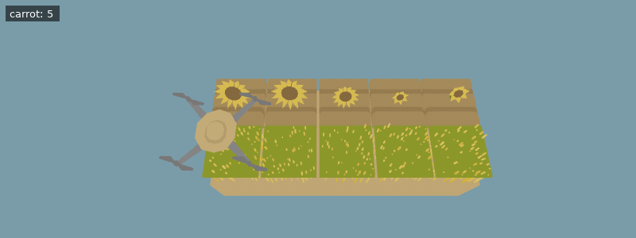

[Documentation index](../../README.md)

[<- Watering](watering.md)

---

# Sunflowers

[Sunflowers](../../objects/sunflower.md) collect the power of the sun. You can harvest that power. 

Planting them works exactly like planting carrots or pumpkins. 

Harvesting a grown sunflower yields power.
If there are at least 10 sunflowers on the farm and you harvest one with the largest number of petals, you get `8` times more power!
If you harvest a sunflower while there is another sunflower with more petals, the next sunflower you harvest will also only give you the normal amount of power (not the 8x bonus).

`measure()` returns the number of petals of the sunflower under the drone.
Sunflowers have at least `7` and at most `15` petals.
Even before they are fully grown, sunflowers can already be measured and count towards the 10 sunflower limit.

Several sunflowers can have the same number of petals, so there may be several with the largest number. In this case, it doesn't matter which one you harvest.

**Example conditions**

```json
{
  "inventory_scale": 5,
  "items": [
    {
      "item": "carrot",
      "n": 10
    }
  ],
  "world_size": {
    "x": 5,
    "y": 2
  },
  "execution_speed": 2,
  "digging_speed": 1,
  "action_ticks": 200,
  "operation_ticks": 1,
  "seed": 4,
  "exclude_unlocks": [
    "fertilizer",
    "watering"
  ],
  "starting_chunk": 0,
  "dlc_enabled": false
}
```

**Example setup**

```python
move(North)
for _ in range(5):
    till()
    plant(Entities.Sunflower)
    move(East)
move(North)
do_a_flip()
do_a_flip()
do_a_flip()
do_a_flip()
do_a_flip()
```

**Example code**

```python
for _ in range(5):
    till()
    plant(Entities.Sunflower)
    print(measure())
    move(East)
for _ in range(5):
    while not can_harvest():
        pass
    harvest()
    move(East)
```

<details>
<summary>Animated example</summary>



*Offline recreation using extracted game models; simplified visuals. Clips are limited to 30 seconds.*

</details>

As long as you have power, the drone will use it to run twice as fast.
It consumes 1 power every 30 actions, such as moves, harvests, or planting actions.
Executing other code statements can also use power, but much less than drone actions.

In general, everything that is sped up by speed upgrades is also sped up by power.
Anything sped up by power also uses power proportional to the time it takes to execute it, ignoring speed upgrades.

---

[Stats](../stats.md)      [Lists](../scripting/lists.md)      [Dictionaries](../scripting/dicts.md)      [Variables](../scripting/variables.md)      [For Loop](../scripting/for.md)      [If](../scripting/if.md)      [Operators](../scripting/operators.md)

[harvest()](../../code/harvest.md)      [plant()](../../code/plant.md)      [move()](../../code/move.md)      [till()](../../code/till.md)      [measure()](../../code/measure.md)

Source: `EN/docs/unlocks/sunflowers.md`.
