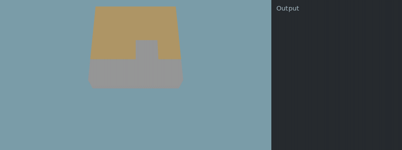

[Documentation index](../../README.md)

[<- Iron](iron.md)

---

# Treasure Map

Legends tell of an elusive treasure hidden by a long-dead, forgetful pirate – or something like that. What if they wrote the path to the treasure on a map and then lost it? Maybe they dropped the map when cornered by a river of lava, and it was preserved below a layer of basalt.

Measuring the basalt blocks might reveal something!

**Tell me more**

You should look out for a layer of `Grounds.Basalt`. Try measuring the basalt and see what it tells you. The hint might lead you to the treasure map and measuring the map will surely return you the path to the treasure itself – but can you decipher the instructions the map gives you?

**Just tell me how**

Okay, here's the deal: Find the `Grounds.Basalt` stratum and the `Grounds.Treasure_Map` block directly below it. You can `measure()` the basalt to get the `(x, y)` position of the map block below.

Call `measure()` on the map block to get the treasure path as a string of direction letters. N, E, S, and W stand for `North`, `East`, `South`, and `West`, respectively, while D stands for "Down" or "Dig." These letters describe a path made of `Grounds.Treasure_Path` blocks that leads to the treasure.

**Example conditions**

```json
{
  "items": [],
  "world_size": {
    "x": 4,
    "y": 4
  },
  "execution_speed": 2,
  "digging_speed": 10,
  "action_ticks": 200,
  "operation_ticks": 200,
  "seed": 3,
  "exclude_unlocks": [
    "watering",
    "fertilizer",
    "dynamite",
    "iron"
  ]
}
```

**Example setup**

```python
jump(Unlocks.Treasure_Map)
```

**Example code**

```python
# Find the basalt layer
while get_ground_type() != Grounds.Basalt:
    dig()

# Measuring the basalt returns the position of the treasure map
map_pos = measure()

while get_pos_x() < map_pos[0]:
    move(East)
while get_pos_y() < map_pos[1]:
    move(North)

while get_ground_type() != Grounds.Treasure_Map:
    dig()

# Found the map, measure it to get the path
do_a_flip()
instructions = measure()
print("instructions: ", instructions)

# Dig into the map to start the treasure hunt
dig()
```

<details>
<summary>Animated example</summary>



*Offline recreation using extracted game models; simplified visuals. Clips are limited to 15 seconds.*

</details>

You can use a `for` loop on the string to process it letter by letter:

**Example conditions**

```json
{
  "items": [],
  "world_size": {
    "x": 4,
    "y": 4
  },
  "execution_speed": 2,
  "digging_speed": 10,
  "action_ticks": 200,
  "operation_ticks": 200,
  "seed": 3,
  "exclude_unlocks": [
    "watering",
    "fertilizer",
    "dynamite",
    "iron"
  ]
}
```

**Example setup**

```python
jump(Unlocks.Treasure_Map)
while get_ground_type() != Grounds.Basalt:
    dig()

map_pos = measure()

while get_pos_x() < map_pos[0]:
    move(East)
while get_pos_y() < map_pos[1]:
    move(North)

while get_ground_type() != Grounds.Treasure_Map:
    dig()
```

**Example code**

```python
# The map instructions are returned as a single string
instructions = measure()
# Use for-in to split the string into letters
for letter in instructions:
    print(letter)
```

The drone has to stay on top of `Grounds.Treasure_Path` blocks the whole time. If it moves to other ground, the path will break and the treasure will be lost.

## Goal

At the end of the path is a `Grounds.Treasure_Goal` block. If the drone hasn't strayed from the path, an `Entities.Underground_Treasure` will appear on top of it. The drone can `harvest()` the chest to collect its gold.

## Reward

The amount of gold is proportional to the length of the treasure path. Upgrading the Treasure Map unlock increases the path's depth, while upgrading Expand gives it more room to move laterally. Both upgrades increase the treasure path's length and the amount of gold you will find.

## Multiple Drones

The drone that digs into the treasure map block is the drone that has to find the treasure without leaving the path blocks.

---

[Stats](../stats.md)      [For Loop](../scripting/for.md)      [Tuples](../scripting/tuples.md)      [Underground Senses](underground_senses.md)

[harvest()](../../code/harvest.md)      [move()](../../code/move.md)      [dig()](../../code/dig.md)      [measure()](../../code/measure.md)

Source: `EN/docs/unlocks/treasure_map.md`.
