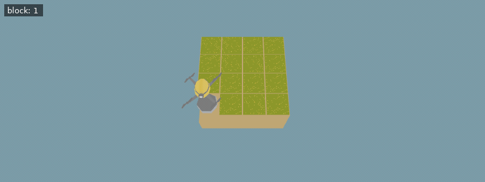

[Documentation index](../../README.md)

[<- Mining](mining.md)

---

# Underground Senses

Let's add a few sensors so your drone can find its way around underground.

## Z-Position

You can now use `get_pos_z()` to get the drone's height (starting at 0 and becoming negative as the drone descends).

**Example conditions**

```json
{
  "exclude_unlocks": [
    "watering",
    "fertilizer"
  ],
  "items": [],
  "world_size": {
    "x": 5,
    "y": 5
  },
  "execution_speed": 2,
  "action_ticks": 200,
  "operation_ticks": 200,
  "seed": 1
}
```

**Example setup**

```python
move(North)
move(North)
move(East)
move(East)
```

**Example code**

```python
print(get_pos_z())
dig()
dig()
dig()
print(get_pos_z())
```

<details>
<summary>Animated example</summary>


*Offline recreation using extracted game models; simplified visuals. Clips are limited to 30 seconds.*

</details>

## Ground Type

`get_ground_type()` returns the type of ground under the drone. You can pass it a direction argument - for example, `get_ground_type(North)` - to get the ground type of a neighboring tile.

Here's how you would check if the block under the drone is dirt:

**Example conditions**

```json
{
  "items": [],
  "exclude_unlocks": [
    "watering",
    "fertilizer"
  ],
  "world_size": {
    "x": 4,
    "y": 4
  },
  "execution_speed": 2,
  "action_ticks": 200,
  "operation_ticks": 200,
  "seed": 1
}
```

**Example code**

```python
dig()
if get_ground_type() == Grounds.Dirt:
    do_a_flip()
```

<details>
<summary>Animated example</summary>



*Offline recreation using extracted game models; simplified visuals. Clips are limited to 30 seconds.*

</details>

## Hardness and Stability

`get_hardness()` returns the hardness of the ground tile under the drone. The higher a tile's hardness, the longer it takes to dig. You can pass it a direction argument, such as `get_hardness(North)`.

`get_stability()` returns the stability of the ground tile under the drone. A stability of 1 means that the block can withstand a height difference of 1 before it caves in. You can pass it a direction argument, such as `get_stability(North)`.

**Example conditions**

```json
{
  "items": [],
  "exclude_unlocks": [
    "watering",
    "fertilizer"
  ],
  "world_size": {
    "x": 5,
    "y": 5
  },
  "execution_speed": 2,
  "action_ticks": 200,
  "operation_ticks": 20,
  "seed": 0
}
```

**Example setup**

```python
jump(Unlocks.Rice)
```

**Example code**

```python
print(get_hardness(), "|", get_stability())
while get_hardness() == 1:
    dig()

print(get_hardness(), "|", get_stability())
while get_hardness() == 2 and get_stability() == 3:
    dig()
```

<details>
<summary>Animated example</summary>


*Offline recreation using extracted game models; simplified visuals. Clips are limited to 30 seconds.*

</details>

Note that the four blocks directly next to the drone are removed regardless of their stability as the drone digs down, unless the block has a special function. Clay, iron, and quartz, for example, are not removed by this rule. They're still susceptible to cave-ins due to lack of block stability, however.

---

[Mining](mining.md)      [Senses](senses.md)

[get_pos_z()](../../code/get_pos_z.md)      [get_ground_type()](../../code/get_ground_type.md)      [get_hardness()](../../code/get_hardness.md)      [get_stability()](../../code/get_stability.md)

Source: `EN/docs/unlocks/underground_senses.md`.
