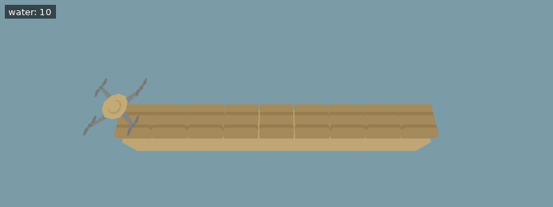

[Documentation index](../../README.md)

[<- Carrots](carrots.md)  | [Fertilizer ->](fertilizer.md)
 | [Sunflowers ->](sunflowers.md)

---

# Watering

Plants grow faster when they are watered. The ground has a water level ranging from `0` to `1`.
The function `get_water()` returns the water level of the ground beneath the drone.

A plant's growth speed scales linearly from 1x at water level 0 to 5x at water level 1.

The ground dries out over time. On average, it loses 1% of its current water per second, with some random variation. Maintaining a high water level consumes much more water than maintaining a low one.

You can use water on your plants. One tank of water is automatically added to your inventory every 10 seconds.
Upgrading `Unlocks.Watering` will double the amount of water you get every 10 seconds.

A tank holds `0.25` water.

Call `use_item(Items.Water)` over any ground to water the ground.

**Example conditions**

```json
{
  "items": [
    {
      "item": "water",
      "n": 10
    }
  ],
  "world_size": {
    "x": 9,
    "y": 1
  },
  "execution_speed": 2,
  "digging_speed": 1,
  "action_ticks": 200,
  "operation_ticks": 1,
  "seed": 1,
  "exclude_unlocks": [
    "fertilizer"
  ],
  "starting_chunk": 0,
  "dlc_enabled": false
}
```

**Example setup**

```python
for _ in range(9):
    till()
    move(East)
```

**Example code**

```python
for i in range(5):
    if i > 0:
        use_item(Items.Water, i)
    plant(Entities.Tree)
    print(get_water())
    move(East)
    move(East)
```

<details>
<summary>Animated example</summary>



*Offline recreation using extracted game models; simplified visuals. Clips are limited to 15 seconds.*

</details>

---

[Fertilizer](fertilizer.md)

[use_item()](../../code/use_item.md)      [get_water()](../../code/get_water.md)

Source: `EN/docs/unlocks/watering.md`.
